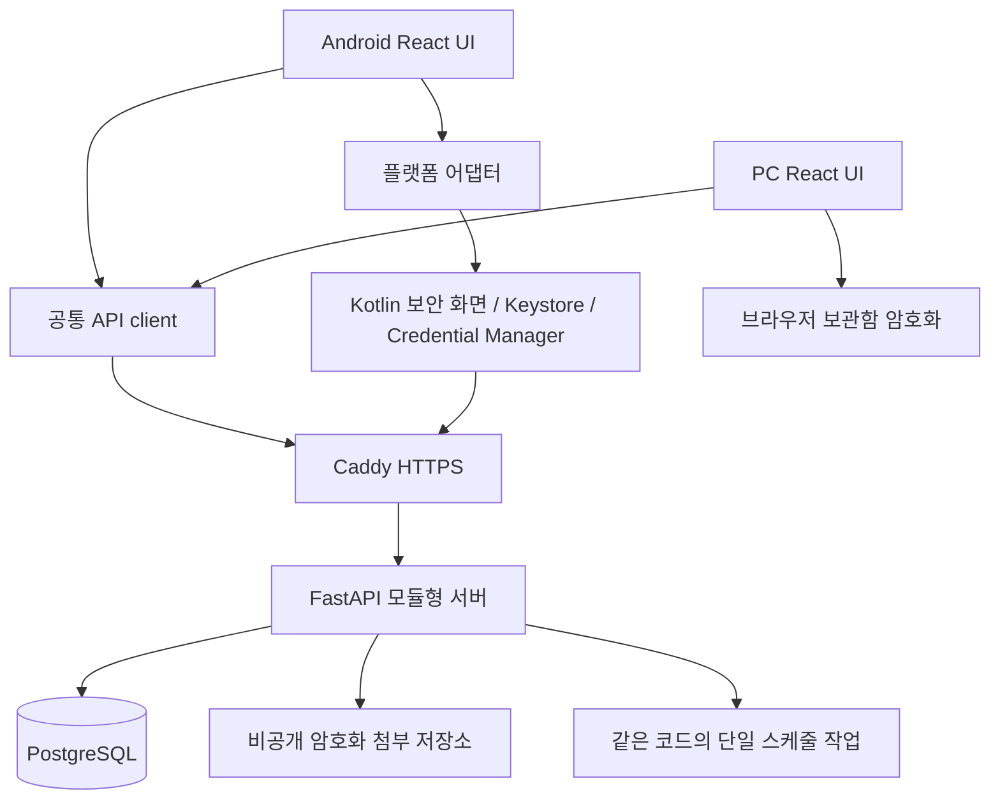

# 아키텍처

## 1. 결정

하나의 Git 저장소, 하나의 공통 React UI, 하나의 모듈형 FastAPI 서버, 하나의 PostgreSQL DB를 사용한다.
Android는 Capacitor에 번들된 정적 웹 자산을 실행하고 Kotlin 모듈로 기기 기능을 사용한다.
PC는 HTTPS로 배포한 같은 UI를 사용한다. 원격 웹 페이지를 Android 보안 bridge에 그대로 로드하지 않는다.
Capacitor의 웹/네이티브 경계와 환경 요건은 [S01, S02](references.md)를 참고한다.



## 2. 목표 디렉터리

아래는 구현 시 만들 구조이며 초기 문서 패키지에 코드가 있다는 뜻이 아니다.

```text
apps/client/                  React + Vite + Capacitor 프로젝트
  src/features/               dashboard, assets, cashflow, cards, insurance, homecare
  src/platform/               web / android adapter
  android/                    Gradle 프로젝트 (생성 후 관리 대상)
services/api/                 FastAPI 도메인과 Alembic
packages/api-client/           OpenAPI에서 생성한 TS client
packages/test-fixtures/        합성 계약/계산 테스트 벡터
plugins/sallimbook-auth/       SallimBookAuth TypeScript 계약(구현은 apps/client/android의 Kotlin)
infra/                        Compose, Caddy, 운영 템플릿
scripts/                      검증/개발/게시 도구
planning/                     마일스톤과 Issue 원본
docs/                         설계·운영·ADR
```

## 3. 서버 모듈과 책임

| 모듈 | 소유 데이터와 규칙 |
|---|---|
| identity | 사용자, 가계 구성원, 초대, 인증기, 세션, 기기 등록 |
| assets | 자산/부채 항목, 금융계좌, 월별 스냅샷, 확정·정정 |
| cashflow | 제한된 금전 기록, 월 수입 뷰, 고정비 규칙/회차/납부 |
| cards | 카드 메타데이터, 결제계좌, 사용 종료와 정기결제 참조 |
| vault | 암호문·키 wrapping 저장과 권한; 서버 복호화는 하지 않음 |
| insurance | 계약·보장·의료 사건·비용·청구·지급 배분 |
| homecare | 가전·소모품·재고 원장·교체 이력 |
| documents | 첨부 검사/인증 다운로드/암호화 파일 관리 |
| audit | 비밀을 제외한 변경자·요청·버전·상태 이력 |
| reporting | 읽기 전용 집계. 금액을 중복 복제해 소유하지 않음 |

한 모듈이 다른 모듈의 테이블을 직접 수정하지 않는다. 트랜잭션 경계의 application service를 통해 실행한다.
같은 DB 안에서 보험금 기록·배분과 월간 수입 원본을 원자적으로 생성한다.
고정비 회차 생성은 외부 메시지 브로커 없이 idempotent CLI/스케줄 작업으로 시작한다.

## 4. 데이터 기준과 동기화

서버가 공동 기록의 기준이다. v1은 online-first이고 완전한 오프라인 편집은 제외한다.
React Query 캐시는 메모리 중심이며 민감한 응답은 영구 브라우저 캐시/Service Worker에 저장하지 않는다.
서버 응답에 version·updated_at을 포함하고 수정에는 If-Match 또는 expected_version을 보낸다.
저장 후 관련 쿼리를 무효화한다. 다른 기기는 화면 포커스·앱 복귀·수동 새로고침 시 갱신한다.
초기에는 실시간 WebSocket이 필요 없다. 오래된 데이터에는 마지막 갱신 시각을 표시한다.

네트워크가 끊기면 성공으로 표시하지 않는다. 입력 도중 일시 단절은 현재 프로세스 메모리에 임시 유지하되,
앱 잠금·로그아웃 시 민감 입력은 버린다. 내구성 있는 오프라인 보관은 후속 ADR 없이 추가하지 않는다.

## 5. 보안 경계

- 일반 계좌번호·문서: 서버 관리형 암호화와 접근 통제. 서버 운영자는 신뢰 주체다.
- 카드 PAN/유효기간: 클라이언트 암호화. 서버에는 암호문·nonce·키 wrapping만 있다.
- CVC: Android 네이티브 입력/암호화/표시; 서버 API와 JS bridge 평문 경로가 없다.
- 로그인 인증과 vault 암호키는 독립이다. 사용자 인증 복구가 vault 자동 복구를 의미하지 않는다.
- WebView가 손상되면 일반 데이터는 영향을 받을 수 있다. 네이티브 보안 화면은 임의 URL·문자열 복호화 기능을 노출하지 않는다.

## 6. 배포와 접근

상시 운영 호스트에 Caddy + API + PostgreSQL + 파일 volume을 배치한다.
사용자는 현재 PC의 WSL 운영을 선택했다. PC/WSL 중단 시 서비스도 중단되는 제약을 운영 문서에 남긴다.
기존 서비스에 영향을 주지 않는 별도 Compose 프로젝트와 전용 Tailscale 노드를 사용한다.
앱/API는 기본 사설 HTTPS이며, 명시적으로 선택한 배포는 전용 노드의 8443을 Funnel로 공개한다.
443은 패스키 검증 정적 파일만 제공한다. 공개 모드는 신규 가계 생성을 끄고 기존 계정 인증을 유지한다.
[운영·앱 식별자 결정](adr/private-network-and-app-identity.md)에 따라 기존 호스트의 Serve/Funnel 설정을 변경하지 않는다.
Android API origin과 PC web origin은 명시적 allowlist로 설정한다. CORS는 인증 대체 수단이 아니다.

## 7. 확장 지점

후속 상세 거래는 기존 account/card ID와 연결한다. snapshot을 자동 대체하지 않고 대조 후보를 만든다.
후속 OCR은 입력 초안만 만들고 확인된 비용/지급을 자동 확정하지 않는다.
외부 금융 데이터 수집기는 서버 도메인 규칙을 우회하지 않는 import adapter로 추가한다.
