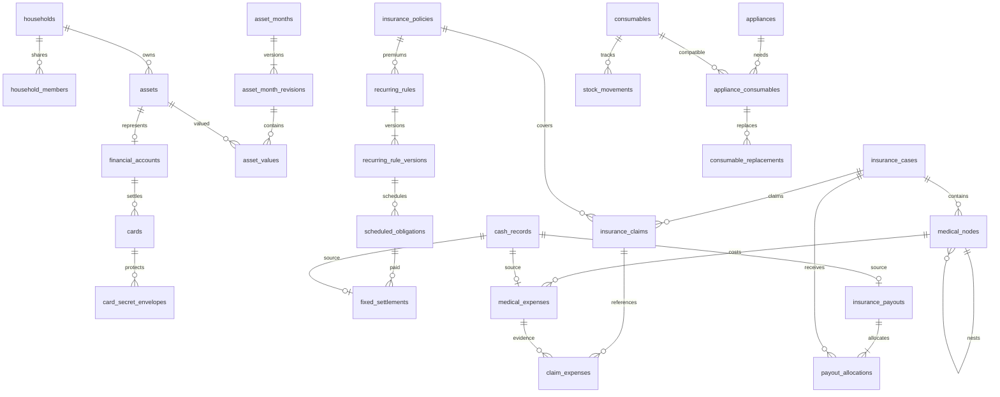

# DB 모델 · 논리 스키마

상태: 구현용 논리 모델. 실제 DDL/Alembic migration은 개발 단계에서 작성·검증한다.
테이블 명세에 없는 임의의 PAN/CVC 평문 칼럼을 추가하지 않는다.
SB-002의 실제 migration `0001_households`는 가계 루트와 KRW/Asia·Seoul/version 제약만 생성한다.
아래의 나머지 테이블은 담당 Issue의 migration에서 순차적으로 추가한다.
공통 ORM은 UUID·UTC timestamp·낙관적 version을 제공하며, `KrwNumeric` 바인딩은
float·소수 원·20자리 초과 금액을 DB 반올림 전에 거부한다. 새 DB에 사용자 가계를 자동 생성하지 않는다.

## 1. 공통 타입과 규칙

| 요소 | 규칙 |
|---|---|
| 식별자 | UUID, API는 문자열 |
| 가계 | 가계 소속 테이블은 household_id NOT NULL |
| 시간 | created_at/updated_at timestamptz, UTC; occurred_on/as_of_date는 date |
| 금액 | KRW numeric(20,0), API string; 필요 외화 참고 numeric(20,4) |
| 월 | period_month date, 월의 첫날 CHECK |
| 수정 | version bigint, created_by/updated_by, 낙관적 잠금 |
| 종료 | archived_at/ended_on 등 의미 있는 상태 필드 |
| 암호문 | bytea + nonce + schema_version + key_version, 비밀과 메타데이터 분리 |
| 삭제 | 이력 FK는 RESTRICT, 참조 없는 임시 객체만 제한적 CASCADE |

아래 표는 공통 필드를 제외한 주요 필드를 표시한다.
부모의 `(household_id,id)`에 UNIQUE를 두고 자식에서 같은 쌍으로 FK를 건다.
가계 내 역할 검사는 API에서 매 요청 수행한다. UUID가 어렵다는 이유로 권한 검사를 생략하지 않는다.

## 2. 계정·가계·인증

| 테이블 | 핵심 필드 | 제약·용도 |
|---|---|---|
| users | id, login_name, display_name, password_hash, disabled_at | login_name unique; 평문 비밀번호 금지 |
| households | id, name, timezone, base_currency | v1 Asia/Seoul, KRW |
| household_members | id, household_id, user_id, role, status | unique(household_id,user_id); active 최대 2는 트랜잭션 내 검사 |
| invitations | token_hash, household_id, intended_login, expires_at, used_at | 일회성 초대; 원본 토큰 영구 저장 금지 |
| auth_credentials | user_id, credential_id, public_key, sign_count, transports, backed_up | 패스키 credential_id unique; 비밀키 없음 |
| auth_sessions | user_id, device_id?, session_hash, refresh_hash?, expires_at, revoked_at, last_seen_at | 웹 세션/Android refresh 갱신·폐기 |
| registered_devices | user_id, household_id, label, platform, status, last_seen_at | 기기 해지와 세션 제거 연계; 키 원문 없음 |
| auth_challenges | user_id?, kind, challenge_hash, expires_at, consumed_at | 등록·로그인·step-up 재생 방지 |

부부의 법적 실명·연락처는 필수값으로 강제하지 않는다. 초기 데이터에는 합성 표시명만 둔다.

## 3. 자산·금융계좌·월간 기록

| 테이블 | 핵심 필드 | 제약·용도 |
|---|---|---|
| assets | id, kind(asset/liability), category, name, owner_member_id?, ownership_kind, household_share, amount_basis, started_on, ended_on, inclusion_status | 금융·부동산·보증금·대출 공통 집계 단위 |
| financial_accounts | asset_id, institution_name, account_type, account_number_ciphertext, number_key_version, masked_number, purpose, opened_on, closed_on | asset_id unique; 계좌별 자산 중복 없음 |
| asset_months | household_id, period_month, current_revision_id | unique(household_id,period_month) |
| asset_month_revisions | month_id, revision_no, state, confirmed_at, reopened_reason, previous_revision_id? | unique(month_id,revision_no), 완료본 보존 |
| asset_values | revision_id, asset_id, input_amount_krw?, owned_amount_krw?, as_of_date?, verification_state, origin(carried/manual), change_reason | unique(revision_id,asset_id); null과 0 구분 |

계좌 유형 enum: checking, savings, term_deposit, brokerage, pension_savings, irp, dc_pension, isa, cma, other.
연금저축보험 같은 상품은 보험계약이 평가용 asset_id를 참조할 수 있다. 동일 평가액의 계좌를 따로 더하지 않는다.
자산의 소유 정보는 자산에 둔다. 계좌 화면은 이를 표시한다.
부채 입력은 남은 원금 중심이며 미래 이자 총합을 현재 부채로 자동 더하지 않는다.

## 4. 카드와 보관함

| 테이블 | 핵심 필드 | 제약·용도 |
|---|---|---|
| cards | owner_member_id, issuer_name, product_name, alias, card_type, last_four, settlement_day?, settlement_account_id?, status | 일반 API에는 마스킹 정보만 |
| vault_versions | household_id, key_version, state, created_by | unique(household_id,key_version) |
| vault_member_wrappings | member_id, key_version, kdf_name, kdf_params, salt, wrap_nonce, wrapped_key | unique(member_id,key_version); 각 구성원의 별도 암호 |
| vault_recovery_wrappings | household_id, key_version, wrap_nonce, wrapped_key, recovery_generation | 서버에 복구코드 원문 없음 |
| card_secret_envelopes | card_id, key_version, schema_version, nonce, ciphertext | 카드/버전 유일성; PAN·유효기간만 payload에 포함 |

서버에는 CVC 칼럼도 CVC blob도 존재하지 않는다.
Android 로컬 저장: card_id → encrypted_cvc + nonce + local_key_alias + local_schema_version.
Android의 HVK wrapping도 로컬에만 존재하며 서버의 device 행에 원본키를 넣지 않는다.
보관함 새 키 버전의 전체 카드 재암호화가 완료되기 전 current version을 전환하지 않는다.

## 5. 수입·고정 납부·공통 금전 기록

| 테이블 | 핵심 필드 | 제약·용도 |
|---|---|---|
| cash_records | kind, flow(in/out), amount_krw, period_month, occurred_on?, date_precision(day/month), member_id?, account_id?, card_id?, reverses_id?, state, note | 확인된 원본 1건; amount>0; 카드/계좌 동시 지정 금지 |
| recurring_rules | category, title, source_policy_id?, source_liability_asset_id?, state | 보험·대출과 연결, 수동 일반 구독 가능 |
| recurring_rule_versions | rule_id, revision_no, effective_from, effective_to?, frequency, interval_count, anchor_day, amount_mode, expected_krw?, native_currency?, native_amount?, payment_card_id?, payment_account_id? | 적용 기간 비중첩; 확정 과거 회차 불변 |
| scheduled_obligations | rule_id, rule_version_id, occurrence_key, scheduled_on, expected_krw?, principal_krw?, interest_krw?, status | unique(rule_id,occurrence_key); 재생성 중복 금지 |
| fixed_settlements | obligation_id, cash_record_id, principal_krw?, interest_krw?, economic_type | cash_record_id unique; 분할 납부 N건 가능 |

cash_records.kind 예시: salary, bonus, other_income, fixed_payment, medical_payment,
medical_refund, insurance_receipt, insurance_return, income_return.
보험금 수령 subtype는 insurance_payouts를 참조한다. 월간 수입은 cash_records의 분류별 projection이며 별도 수입 복제 테이블을 만들지 않는다.
medical_payment/fixed_payment/insurance_receipt는 해당 subtype가 정확히 1개 생기는 서비스 트랜잭션으로 처리한다.
공통 원장 도입이 아니라 제한된 이벤트의 중복 제거다. `account.balance += amount` 같은 동작은 없다.

`reverses_id`는 실제 환불/반환 원본에 연결한다. 같은 가계, 적절한 반대 방향, 누적 반환액 상한을 검증한다.
오입력 void와 실제 환불은 구분한다. void는 정정 이력, refund는 별도 현금 사실이다.

## 6. 보험계약·사건·청구·지급

| 테이블 | 핵심 필드 | 제약·용도 |
|---|---|---|
| insurance_policies | insurer, product_name, policy_number_ciphertext, policyholder_member_id?, insured_member_id?, beneficiary_note, coverage_start, coverage_end?, payment_end?, status, valuation_asset_id? | 보험료는 연결 규칙에서 읽음 |
| insurance_coverages | policy_id, name, benefit_type, insured_amount_krw?, coverage_start?, coverage_end?, note | 정액/실손/기타 설명; 자동 보상 판정 아님 |
| insurance_cases | title, patient_member_id, diagnosis_note?, diagnosis_code?, start_on, end_on?, treatment_state, financial_state | 사건은 보험계약의 자식이 아님 |
| medical_nodes | case_id, parent_id?, kind, label, provider_name?, start_on?, end_on?, sort_order, note | 같은 사건 부모만 허용; 순환 금지 |
| medical_expenses | case_id, node_id, cash_record_id, provider_name?, receipt_reference?, gross_medical_krw?, public_coverage_krw? | cash_record_id unique; 실제 지불액은 cash_records |
| medical_expense_lines | expense_id, label, amount_krw, detail_type | 영수증 원본 금액의 분해; 독립 지출 아님 |
| medical_refunds | expense_id, cash_record_id, reason | 원본 지출 연결; 누적 실제 환불 검증 |
| insurance_claims | case_id, policy_id, claim_reference?, submitted_on?, requested_krw?, claim_state, decision_note? | 사건1/계약1; 비용 N개 연결 |
| claim_expenses | claim_id, expense_id | unique(claim_id,expense_id); 같은 사건 검증 |
| insurance_payouts | cash_record_id, received_on, receiving_account_id?, insurer_note, state | cash_record_id unique; 실제 입금 1건 |
| payout_allocations | payout_id, case_id, policy_id?, claim_id?, benefit_type, amount_krw | claim_id는 선택; 원본 입금 합계와 일치 |
| insurance_returns | payout_id, original_allocation_id, cash_record_id, returned_on, reason | 원본 배분에서 반환액 차감; 중복 수입 방지 |

한 사건이 여러 계약으로 보장되므로 insurance_cases에 단일 policy_id를 강제하지 않는다.
진료비 1건이 여러 claim_expenses에 등장해도 비용 원본은 1개다.
단일 지급이 여러 사건에 걸치면 payout_allocations로 나누며 각 사건 통계는 배분 기준, 월 수입은 입금 기준이다.
수술비 정액 지급을 진료비와 강제로 1:1 연결하지 않는다.

## 7. 가전·소모품

| 테이블 | 핵심 필드 | 제약·용도 |
|---|---|---|
| appliances | name, manufacturer, model, location, purchased_on?, purchase_price_krw?, seller?, warranty_until?, status | 구매 가격은 순자산 자동 반영 없음 |
| consumables | name, sku_or_model, unit, stock_quantity, low_stock_threshold | household 단위 공용 재고, version으로 잠금 |
| appliance_consumables | appliance_id, consumable_id, interval_unit, interval_count?, next_check_override?, note | unique(appliance_id,consumable_id); 기기별 교체 기준 |
| stock_movements | consumable_id, kind, quantity_delta, occurred_on, unit_cost_krw?, reversal_of?, reason? | 0 변화 금지; 조정 사유 필수 |
| consumable_replacements | appliance_consumable_id, stock_movement_id, replaced_on, quantity, note | stock_movement_id unique; 취소는 반대 movement |

stock_quantity는 movement 합계의 트랜잭션 내 캐시다. 정기 검증으로 양쪽이 일치하는지 확인한다.
동일 필터가 두 기기에 호환되면 재고는 한 군데, 교체일은 기기별 두 군데다.

## 8. 첨부·감사·멱등성

| 테이블 | 핵심 필드 | 제약·용도 |
|---|---|---|
| documents | storage_key, original_name, mime_type, size_bytes, checksum, encryption_key_id, state, uploaded_by | 승인된 비공개 파일; path로 직접 공개 금지 |
| document_links | document_id, policy_id?, case_id?, medical_node_id?, expense_id?, claim_id?, appliance_id?, asset_id? | num_nonnulls(참조 대상)=1, typed FK |
| audit_events | actor_id, entity_type, entity_id, action, request_id, before_version?, after_version?, safe_diff, occurred_at | 비밀/토큰/문서 원문 제외; 일반 금액 정정은 권한 보호 |
| idempotency_records | actor_id, operation, key, request_hash, response_reference, state, expires_at | unique(actor_id,operation,key); 다른 payload 재사용=409 |

파일 업로드는 pending → 검증 → committed, 연결 도중 실패한 orphan은 보존 기간 뒤 정리한다.
가계가 다른 parent와 document를 연결할 수 없다.

## 9. 핵심 관계도

## 10. 반드시 구현할 DB 제약·트랜잭션

- household 일치 composite FK, 동일 snapshot 항목/규칙 회차/수령 원본 unique.
- 부모 이동 시 자기 자신/자손 검사. 노드 삭제는 자식과 비용 존재 여부 확인.
- payout 생성은 cash_records + 지급 + 전체 배분을 한 트랜잭션에서 저장. 배분 합계 불일치는 전체 rollback.
- 납부 생성은 cash_records + settlement + 상태 재계산을 같은 트랜잭션에서 저장.
- 교체는 consumables 행 `FOR UPDATE` → 재고 검사 → movement/replacement → 잔고 갱신.
- 월 확정은 month/revision 잠금 → 유효 항목과 검증 완료 확인 → 확정 상태 전환.
- 모든 변경에서 version을 검사하고 API가 409 충돌을 반환할 수 있게 한다.
- 집계는 비용/배분을 각각 CTE로 사전 합산한 뒤 사건에 조인한다. 원시 N:M 조인 후 SUM 금지.

## 11. 인덱스·성능

기본 목록 인덱스는 `(household_id, status, updated_at, id)`.
월별 조회는 `(household_id, period_month, kind)`, 사건 트리는 `(case_id,parent_id,sort_order)`.
지급 배분 `(case_id,payout_id)`, 예정 납부 `(household_id,scheduled_on,status)`.
개인용 데이터 규모에서 시작하고 실제 explain 결과 없이 과도한 인덱스/파티셔닝을 넣지 않는다.

## 12. 마이그레이션

초기 순서: identity → assets/accounts → cards metadata → insurance contracts → cashflow → insurance cases/claims/payouts → homecare → vault/documents.
단계 간 FK 대상은 먼저 만들고, 순환 참조가 필요하면 별도 migration에서 제약을 추가한다.
각 단계의 테스트 DB 생성·migration round-trip을 검증한다.
운영 데이터가 있는 migration은 백업/복구와 하위 호환 API 기간을 먼저 계획한다.
금액·키·암호문 타입 변경을 자동 정리라는 이름으로 소실시키지 않는다.
