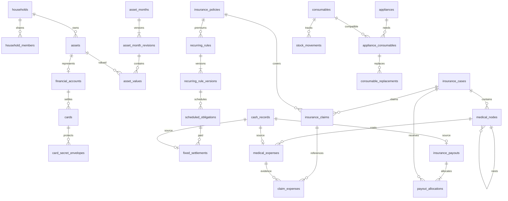

# DB 모델 · 논리 스키마

상태: 구현용 논리 모델. 실제 DDL/Alembic migration은 개발 단계에서 작성·검증한다.
테이블 명세에 없는 임의의 PAN/CVC 평문 칼럼을 추가하지 않는다.
SB-002의 `0001_households`는 가계 루트와 KRW/Asia·Seoul/version 제약을 생성한다.
SB-005/007의 `0002_identity_auth`는 사용자·구성원·초대·기기·세션·refresh 이력·요청 제한·멱등 기록을 추가한다.
SB-006의 `0003_passkeys`는 `auth_credentials`, `auth_challenges`, `auth_step_up_grants` 세 테이블을 추가한다.
SB-010의 `0004_assets`는 자산 식별 정보와 `audit_events`를 추가한다.
SB-011의 `0005_accounts`는 금융 자산과 1:1 연결되는 `financial_accounts`를 추가한다.
SB-012의 `0006_asset_months`는 월·revision·확인 금액과 확정 이력의 DB 변경 차단을 추가한다.
아래 나머지 업무 테이블은 담당 Issue의 migration에서 순차적으로 추가한다.
공통 ORM은 UUID·UTC timestamp·낙관적 version을 제공하며, `KrwNumeric` 바인딩은
float·소수 원·20자리 초과 금액을 DB 반올림 전에 거부한다. 새 DB에 사용자 가계를 자동 생성하지 않는다.

## 1. 공통 타입과 규칙

| 요소 | 규칙 |
|---|---|
| 식별자 | UUID, API는 문자열 |
| 가계 | 가계 소속 테이블은 household_id NOT NULL |
| 시간 | created_at/updated_at timestamptz, UTC; occurred_on/as_of_date는 date |
| 금액 | KRW numeric(20,0), API string; 필요 외화 참고 numeric(20,4) |
| 월 | period_month date, 월의 첫날 CHECK |
| 수정 | version bigint, created_by/updated_by, 낙관적 잠금 |
| 종료 | archived_at/ended_on 등 의미 있는 상태 필드 |
| 암호문 | bytea + nonce + schema_version + key_version, 비밀과 메타데이터 분리 |
| 삭제 | 이력 FK는 RESTRICT, 참조 없는 임시 객체만 제한적 CASCADE |

아래 표는 공통 필드를 제외한 주요 필드를 표시한다.
부모의 `(household_id,id)`에 UNIQUE를 두고 자식에서 같은 쌍으로 FK를 건다.
가계 내 역할 검사는 API에서 매 요청 수행한다. UUID가 어렵다는 이유로 권한 검사를 생략하지 않는다.

## 2. 계정·가계·인증

| 테이블 | 핵심 필드 | 제약·용도 |
|---|---|---|
| users | id, login_name, display_name, password_hash, disabled_at | login_name unique; 평문 비밀번호 금지 |
| households | id, name, timezone, base_currency | v1 Asia/Seoul, KRW |
| household_members | id, household_id, user_id, slot, role, status | slot 1/2 CHECK + 활성 (가계,slot) partial UNIQUE; 가계 잠금과 함께 최대 2명 보장 |
| invitations | token_hash, household_id, intended_login, expires_at, used_at | 일회성 초대; 원본 토큰 영구 저장 금지 |
| auth_credentials | household_id, user_id, created_device_id, credential_id, public_key, rp_id, label, sign_count, aaguid, transports, device_type, backed_up, last_used_at, revoked_at | credential_id 전역 unique; 구성원·등록 기기/사용자 복합 FK; 비밀키 없음 |
| auth_sessions | user_id, device_id?, session_hash, refresh_hash?, expires_at, revoked_at, last_seen_at | 웹 세션/Android refresh 갱신·폐기 |
| refresh_tokens | household_id, session_id, token_hash, expires_at, consumed_at | 소비한 해시도 보존해 이전 refresh 재사용 탐지; 세션 복합 FK |
| login_throttles | key_hash, window_started_at, attempts | 로그인/초대/갱신 시도 제한; 인증 실패에도 카운터는 유지 |
| registered_devices | user_id, household_id, label, platform, status, last_seen_at | 기기 해지와 세션 제거 연계; 키 원문 없음 |
| auth_challenges | household_id?, user_id?, session_id?, device_id?, pending_device_id?, kind, transport, label?, challenge_hash, binding_hash?, policy_hash, action?, target_id?, expires_at, consumed_at | 5분 일회성; ceremony 종류별 필드 조합 CHECK·세션/기기/구성원 FK |
| auth_step_up_grants | household_id, user_id, session_id, device_id, credential_record_id, grant_hash, purpose, target_id, expires_at, consumed_at | 2분 일회성; 목적/대상/세션/기기 바인딩·credential/사용자 복합 FK |

부부의 법적 실명·연락처는 필수값으로 강제하지 않는다. 초기 데이터에는 합성 표시명만 둔다.
실제 `auth_sessions`는 web/native를 구분하고 웹 CSRF 해시와 native access 만료를 분리한다.
refresh 해시는 세션 칼럼 대신 `refresh_tokens` 이력 테이블에 둔다. 기기는 반드시 등록되며 가계·사용자와 복합 FK로 묶는다.
기기 상태는 모든 인증/refresh의 폐기 기준이다. 요청 중 기기 행 갱신과 세션 잠금의 순서 역전을 피하기 위해
활동 시각은 세션에서 집계하고, 기기 폐기 시 다른 세션을 일괄 잠그지 않는다.

패스키의 `credential_id`는 1~1023바이트, 공개키는 1~8192바이트, sign_count는 0~4294967295로 제한한다.
등록 시 검증한 `device_type`을 보존하고 인증 시 같은 유형인지 확인한다. 동기화 패스키의 0 카운터와
양수 카운터의 증가 검증은 WebAuthn 라이브러리 규칙을 따른다. 비밀키·생체정보·평문 challenge는 저장하지 않는다.
`policy_hash`는 RP ID·허용 origin·transport를 연결해 발급 후 정책이 바뀐 challenge를 거부한다.
로그인 challenge의 기기 바인딩과 step-up 증명도 원문 대신 구분된 토큰 해시를 저장한다.
`pending_device_id`는 로그인 성공 시 실제 등록 기기 ID로 사용하며, 발급 시에는 아직 기기 행이 없다.
알 수 없는 계정의 로그인 challenge는 가계·사용자가 함께 null이다. 그 외 등록/step-up과 증명은 가계·사용자를 요구한다.
따라서 이 미인증 로그인 challenge만 공통 household_id NOT NULL 규칙의 제한적인 예외다.
challenge/credential 카운터와 grant 소비는 행 잠금으로 직렬화한다. 증명 소비는 보호 동작과 함께 commit하며,
검증 실패로 소비된 challenge는 되살리지 않는다. 목적별 증명은 세션의 최근 로그인 시각을 바꾸지 않는다.
`auth_challenges.expires_at`과 `auth_step_up_grants.expires_at`에 만료 정리 인덱스를 둔다.
새 ceremony 생성 시 만료 행만 각 100건 이하로 잠금 건너뛰기 방식으로 삭제하며, 정리는 같은 트랜잭션을 사용한다.
현재 유효하거나 다른 검증/동작이 잠근 행을 정리 때문에 삭제하거나 대기하지 않는다.

## 3. 자산·금융계좌·월간 기록

| 테이블 | 핵심 필드 | 제약·용도 |
|---|---|---|
| assets | id, kind(asset/liability), category, name, owner_member_id?, ownership_kind, household_share, amount_basis, started_on, ended_on, inclusion_status | 금융·부동산·보증금·대출 공통 집계 단위 |
| financial_accounts | asset_id, institution_name, account_type, account_number_ciphertext?, number_nonce?, number_key_version?, last_four?, purpose?, opened_on?, created_by_member_id, updated_by_member_id | asset_id unique; 가계·자산 및 작성/수정 구성원 복합 FK; 번호 envelope 전체 null 또는 전체 유효 |
| asset_months | household_id, period_month, current_revision_id | unique(household_id,period_month) |
| asset_month_revisions | month_id, revision_no, state, confirmed_at, reopened_reason, previous_revision_id? | unique(month_id,revision_no), 완료본 보존 |
| asset_values | revision_id, asset_id, source_asset_version, name, kind, category, ownership_kind, owner_member_id?, household_share, amount_basis, inclusion_status, started_on, ended_on?, input_amount_krw?, owned_amount_krw?, as_of_date?, verification_state, origin(carried/manual), origin_revision_id?, change_reason? | unique(revision_id,asset_id); 금액과 당시 범위의 독립 보존; null과 0 구분 |

계좌 유형 enum: checking, savings, term_deposit, brokerage, pension_savings, irp, dc_pension, isa, cma, other.
연금저축보험 같은 상품은 보험계약이 평가용 asset_id를 참조할 수 있다. 동일 평가액의 계좌를 따로 더하지 않는다.
자산의 소유 정보는 자산에 둔다. 계좌 화면은 이를 표시한다.
부채 입력은 남은 원금 중심이며 미래 이자 총합을 현재 부채로 자동 더하지 않는다.

현재 자산은 개별 소유 시 활성 구성원 한 명, 공동 소유 시 단일 소유자 없이 한 행으로 저장한다.
가계 지분은 0~1의 정확한 십진 문자열이며 소수점 아래 최대 18자리다. DB numeric scale CHECK도 이를 검증한다.
`whole`과 `owned` 입력 기준을 구분하며 금액을 등록/수정하는 필드는 자산 metadata에 없다.
종료일과 archived_at은 함께 설정/해제하고, 다른 기록이 참조하는 자산의 물리 삭제는 FK로 거부한다.
계좌의 소유자·종료일·상태는 연결 자산에서 읽으며 계좌에 별도 잔액이나 생명주기 칼럼을 두지 않는다.
연결된 자산은 `kind=asset`, `category=financial`을 유지하고 종료일은 계좌 개설일보다 빠를 수 없다.
계좌번호는 선택 입력이다. 저장 시 AES-256-GCM 암호문·12바이트 nonce·키 버전과 마지막 4자리만 남긴다.
가계·계좌 UUID·필드명·키 버전을 AAD에 넣어 다른 행으로 옮긴 암호문을 거부한다.
자산을 새로 만들며 계좌를 등록할 때 두 행과 감사 행을 한 트랜잭션으로 저장한다.

월의 current revision과 이전 revision은 가계·월 복합 FK로 연결한다. 값 행도 가계·revision·자산을 복합 FK로 검증한다.
확정 revision/값의 UPDATE·DELETE 및 확정본에 대한 값 INSERT는 DB trigger로 거부한다. 값의 소속 identity 이동도 거부한다.
revision의 이전 변경본·재개방 사유·작성자·작성 시각은 생성 시점부터 고정한다. 확정과 동시에 이 이력을 바꾸는 SQL도 거부한다.
값을 수정할 때 revision 행을 함께 잠그므로 확정과 동시 편집은 한쪽만 성공한다.
자산 집합/지분 변경과 월 확인은 가계 행 잠금을 공유한다. 순서는 가계 → 월 → revision → 자산/계좌이며,
인증 세션 잠금이 앞선다. 금액 확인 행의 수정도 revision version을 증가시켜 열린 확정 화면의 충돌을 검출한다.
PATCH에는 revision UUID·값 행 UUID·값 version이 모두 필요하다. 범위에서 제거했다 다시 추가한 행과 새 정정본의 version이
각각 1부터 시작해도 오래된 화면의 저장은 UUID 불일치로 거부한다.
일반 draft는 바뀐 현재 자산 범위를 명시적으로 동기화한 뒤 다시 확인해야 한다. 정정본은 이전 확정본의 당시 범위를
복사하며, 현재 지분·이름이 바뀌었다는 이유로 과거 금액을 자동 재계산하지 않는다.
draft/확정/재개방의 멱등 응답은 원래 revision ID·번호·version을 보존하는 참조다. 재전송 뒤 최신 내용은 별도 GET으로 읽는다.

## 4. 카드와 보관함

| 테이블 | 핵심 필드 | 제약·용도 |
|---|---|---|
| cards | owner_member_id, issuer_name, product_name, alias, card_type, last_four, settlement_day?, settlement_account_id?, started_on?, ended_on? | 일반 API에는 마스킹 정보만 |
| vault_versions | household_id, key_version, state, created_by | unique(household_id,key_version) |
| vault_member_wrappings | member_id, key_version, kdf_name, kdf_params, salt, wrap_nonce, wrapped_key | unique(member_id,key_version); 각 구성원의 별도 암호 |
| vault_recovery_wrappings | household_id, key_version, wrap_nonce, wrapped_key, recovery_generation | 서버에 복구코드 원문 없음 |
| card_secret_envelopes | card_id, key_version, schema_version, nonce, ciphertext | 카드/버전 유일성; PAN·유효기간만 payload에 포함 |

서버에는 CVC 칼럼도 CVC blob도 존재하지 않는다.
Android 로컬 저장: card_id → encrypted_cvc + nonce + local_key_alias + local_schema_version.
Android의 HVK wrapping도 로컬에만 존재하며 서버의 device 행에 원본키를 넣지 않는다.
보관함 새 키 버전의 전체 카드 재암호화가 완료되기 전 current version을 전환하지 않는다.

## 5. 수입·고정 납부·공통 금전 기록

| 테이블 | 핵심 필드 | 제약·용도 |
|---|---|---|
| cash_records | kind, flow(in/out), amount_krw, period_month, occurred_on?, date_precision(day/month), member_id?, account_id?, card_id?, reverses_id?, state, note | 확인된 원본 1건; amount>0; 카드/계좌 동시 지정 금지 |
| recurring_rules | category, title, source_policy_id?, source_liability_asset_id?, state | 보험·대출과 연결, 수동 일반 구독 가능 |
| recurring_rule_versions | rule_id, revision_no, effective_from, effective_to?, frequency, interval_count, anchor_day, amount_mode, expected_krw?, native_currency?, native_amount?, payment_card_id?, payment_account_id? | 적용 기간 비중첩; 확정 과거 회차 불변 |
| scheduled_obligations | rule_id, rule_version_id, occurrence_key, scheduled_on, expected_krw?, principal_krw?, interest_krw?, status | unique(rule_id,occurrence_key); 재생성 중복 금지 |
| fixed_settlements | obligation_id, cash_record_id, principal_krw?, interest_krw?, economic_type | cash_record_id unique; 분할 납부 N건 가능 |

cash_records.kind 예시: salary, bonus, other_income, fixed_payment, medical_payment,
medical_refund, insurance_receipt, insurance_return, income_return.
보험금 수령 subtype는 insurance_payouts를 참조한다. 월간 수입은 cash_records의 분류별 projection이며 별도 수입 복제 테이블을 만들지 않는다.
medical_payment/fixed_payment/insurance_receipt는 해당 subtype가 정확히 1개 생기는 서비스 트랜잭션으로 처리한다.
공통 원장 도입이 아니라 제한된 이벤트의 중복 제거다. `account.balance += amount` 같은 동작은 없다.

`reverses_id`는 실제 환불/반환 원본에 연결한다. 같은 가계, 적절한 반대 방향, 누적 반환액 상한을 검증한다.
오입력 void와 실제 환불은 구분한다. void는 정정 이력, refund는 별도 현금 사실이다.

## 6. 보험계약·사건·청구·지급

| 테이블 | 핵심 필드 | 제약·용도 |
|---|---|---|
| insurance_policies | insurer, product_name, policy_number_ciphertext, policyholder_member_id?, insured_member_id?, beneficiary_note, coverage_start, coverage_end?, payment_end?, status, valuation_asset_id? | 보험료는 연결 규칙에서 읽음 |
| insurance_coverages | policy_id, name, benefit_type, insured_amount_krw?, coverage_start?, coverage_end?, note | 정액/실손/기타 설명; 자동 보상 판정 아님 |
| insurance_cases | title, patient_member_id, diagnosis_note?, diagnosis_code?, start_on, end_on?, treatment_state, financial_state | 사건은 보험계약의 자식이 아님 |
| medical_nodes | case_id, parent_id?, kind, label, provider_name?, start_on?, end_on?, sort_order, note | 같은 사건 부모만 허용; 순환 금지 |
| medical_expenses | case_id, node_id, cash_record_id, provider_name?, receipt_reference?, gross_medical_krw?, public_coverage_krw? | cash_record_id unique; 실제 지불액은 cash_records |
| medical_expense_lines | expense_id, label, amount_krw, detail_type | 영수증 원본 금액의 분해; 독립 지출 아님 |
| medical_refunds | expense_id, cash_record_id, reason | 원본 지출 연결; 누적 실제 환불 검증 |
| insurance_claims | case_id, policy_id, claim_reference?, submitted_on?, requested_krw?, claim_state, decision_note? | 사건1/계약1; 비용 N개 연결 |
| claim_expenses | claim_id, expense_id | unique(claim_id,expense_id); 같은 사건 검증 |
| insurance_payouts | cash_record_id, received_on, receiving_account_id?, insurer_note, state | cash_record_id unique; 실제 입금 1건 |
| payout_allocations | payout_id, case_id, policy_id?, claim_id?, benefit_type, amount_krw | claim_id는 선택; 원본 입금 합계와 일치 |
| insurance_returns | payout_id, original_allocation_id, cash_record_id, returned_on, reason | 원본 배분에서 반환액 차감; 중복 수입 방지 |

한 사건이 여러 계약으로 보장되므로 insurance_cases에 단일 policy_id를 강제하지 않는다.
진료비 1건이 여러 claim_expenses에 등장해도 비용 원본은 1개다.
단일 지급이 여러 사건에 걸치면 payout_allocations로 나누며 각 사건 통계는 배분 기준, 월 수입은 입금 기준이다.
수술비 정액 지급을 진료비와 강제로 1:1 연결하지 않는다.

## 7. 가전·소모품

| 테이블 | 핵심 필드 | 제약·용도 |
|---|---|---|
| appliances | name, manufacturer, model, location, purchased_on?, purchase_price_krw?, seller?, warranty_until?, status | 구매 가격은 순자산 자동 반영 없음 |
| consumables | name, sku_or_model, unit, stock_quantity, low_stock_threshold | household 단위 공용 재고, version으로 잠금 |
| appliance_consumables | appliance_id, consumable_id, interval_unit, interval_count?, next_check_override?, note | unique(appliance_id,consumable_id); 기기별 교체 기준 |
| stock_movements | consumable_id, kind, quantity_delta, occurred_on, unit_cost_krw?, reversal_of?, reason? | 0 변화 금지; 조정 사유 필수 |
| consumable_replacements | appliance_consumable_id, stock_movement_id, replaced_on, quantity, note | stock_movement_id unique; 취소는 반대 movement |

stock_quantity는 movement 합계의 트랜잭션 내 캐시다. 정기 검증으로 양쪽이 일치하는지 확인한다.
동일 필터가 두 기기에 호환되면 재고는 한 군데, 교체일은 기기별 두 군데다.

## 8. 첨부·감사·멱등성

| 테이블 | 핵심 필드 | 제약·용도 |
|---|---|---|
| documents | storage_key, original_name, mime_type, size_bytes, checksum, encryption_key_id, state, uploaded_by | 승인된 비공개 파일; path로 직접 공개 금지 |
| document_links | document_id, policy_id?, case_id?, medical_node_id?, expense_id?, claim_id?, appliance_id?, asset_id? | num_nonnulls(참조 대상)=1, typed FK |
| audit_events | actor_id, entity_type, entity_id, action, request_id, before_version?, after_version?, safe_diff, occurred_at | 비밀/토큰/문서 원문 제외; 일반 금액 정정은 권한 보호 |
| idempotency_records | actor_id, operation, key, request_hash, response_reference, state, expires_at | unique(actor_id,operation,key); 다른 payload 재사용=409 |

파일 업로드 상태는 pending → ready → deleted이며 검증 실패 시 pending을 유지한다.
24시간이 지난 pending에는 업로드할 수 없다. 연결 없는 ready 문서는 명시적 삭제 전까지 보존하며,
DB 참조 없는 암호문이나 삭제 뒤 24시간이 지난 암호문만 정리 명령의 대상이다.
현재 감사 helper는 자원 ID·작업·행 버전·변경 필드명만 저장하며 사용자 입력값을 임의 dict로 받지 않는다.
자산 생성·수정·종료·삭제와 감사 기록을 같은 트랜잭션에서 저장한다. FK 충돌 등으로 실패하면 감사 추가도 롤백한다.
감사 행의 actor_id는 해당 가계의 사용자 복합 FK로 제한한다. 감사 조회 API는 후속 화면 연결에서 추가한다.
가계가 다른 parent와 document를 연결할 수 없다.

`0013_documents`는 documents/document_links와 같은 가계의 typed 복합 FK를 추가한다.
문서 metadata·저장 완료 envelope는 변경할 수 없고 물리 삭제는 차단한다. 링크는 정확히 하나의
대상만 가지며 같은 활성 연결은 유일하다. 링크 삽입은 문서 행을 잠가 동시 삭제와 직렬화한다.
ready 전환에는 활성 링크가 필요하고 deleted 문서는 활성 링크를 가질 수 없다.
링크 종료와 삭제 사유·시각은 보존하며 soft delete가 감사·원본 연결 이력을 없애지 않는다.
저장소의 불투명 UUID 파일명, 키 버전, nonce, checksum과 저장 시각은 DB에서 관리한다.
암호문 파일 생성과 DB commit 사이 장애는 전역 advisory lock을 쓰는 정리 작업으로 회수한다.

## 9. 핵심 관계도

## 10. 반드시 구현할 DB 제약·트랜잭션

- household 일치 composite FK, 동일 snapshot 항목/규칙 회차/수령 원본 unique.
- 부모 이동 시 자기 자신/자손 검사. 노드 삭제는 자식과 비용 존재 여부 확인.
- payout 생성은 cash_records + 지급 + 전체 배분을 한 트랜잭션에서 저장. 배분 합계 불일치는 전체 rollback.
- 납부 생성은 cash_records + settlement + 상태 재계산을 같은 트랜잭션에서 저장.
- 교체는 consumables 행 `FOR UPDATE` → 재고 검사 → movement/replacement → 잔고 갱신.
- 월 확정은 month/revision 잠금 → 유효 항목과 검증 완료 확인 → 확정 상태 전환.
- 모든 변경에서 version을 검사하고 API가 409 충돌을 반환할 수 있게 한다.
- 집계는 비용/배분을 각각 CTE로 사전 합산한 뒤 사건에 조인한다. 원시 N:M 조인 후 SUM 금지.

## 11. 인덱스·성능

기본 목록 인덱스는 `(household_id, status, updated_at, id)`.
월별 조회는 `(household_id, period_month, kind)`, 사건 트리는 `(case_id,parent_id,sort_order)`.
지급 배분 `(case_id,payout_id)`, 예정 납부 `(household_id,scheduled_on,status)`.
개인용 데이터 규모에서 시작하고 실제 explain 결과 없이 과도한 인덱스/파티셔닝을 넣지 않는다.

## 12. 마이그레이션

초기 순서: identity → assets/accounts → cards metadata → insurance contracts → cashflow → insurance cases/claims/payouts → homecare → vault/documents.
현재 적용 순서는 `0001_households` → `0002_identity_auth` → `0003_passkeys` → `0004_assets` → `0005_accounts` → `0006_asset_months`이며 readiness도 이 revision을 요구한다.
단계 간 FK 대상은 먼저 만들고, 순환 참조가 필요하면 별도 migration에서 제약을 추가한다.
각 단계의 테스트 DB 생성·migration round-trip을 검증한다.
운영 데이터가 있는 migration은 백업/복구와 하위 호환 API 기간을 먼저 계획한다.
금액·키·암호문 타입 변경을 자동 정리라는 이름으로 소실시키지 않는다.

### SB-014 구현 상태

`0007_cash_records`는 `cash_records`, `cash_record_revisions`, `income_conversions`를 추가한다. CashRecord 버전별 원본과 전환 묶음은 타입이 있는 행으로 남기고 DB trigger가 UPDATE/DELETE를 거부한다. 일반 audit에는 금액·메모 원문을 복제하지 않는다. 수입의 계좌 연결은 구현됐고 카드 FK는 실제 카드 테이블을 추가하는 migration에서 연결한다. 향후 고정 납부·의료비·보험금 subtype는 공통 cash 생성 helper를 같은 트랜잭션에서 호출하며 수입 API는 임의 subtype 생성을 노출하지 않는다.

### SB-017 구현 상태

`0008_cards`는 카드 metadata와 cash 원본/이력의 `card_id` 복합 FK를 추가한다. 상태는 ended_on에서 파생하며 소유자와 결제계좌도 같은 가계 FK로 묶는다. cash 계좌/카드 배타 선택과 수입·보험금의 카드 사용 금지를 DB CHECK로 검증한다. 기존 cash 행은 card_id가 null인 채로 유지된다. 카드 종료는 cash 이력이나 계좌 연결을 삭제하지 않고, 사용 중인 카드의 물리 삭제는 FK로 차단한다. 일반 카드 테이블에 PAN·유효기간·CVC가 없으며 보관함 암호문도 별도 테이블을 추가할 때 연결한다.

### SB-015/016 구현 상태

`0009_recurring`은 규칙·기간별 규칙 변경본·예상 회차·회차 이력·실제 납부·생성 묶음/참조의 7개 테이블을 추가한다. 기간 중복은 household/rule/daterange GiST exclusion으로 막는다. PostgreSQL 18.6 이미지에 포함된 btree_gist 1.8을 public에 설치하고 명시적 public UUID operator class를 사용하여 테스트 schema 격리를 유지한다. downgrade는 다른 schema도 쓰는 extension을 제거하지 않는다.
규칙 조건·회차 이력·실납부 분해·생성 응답 참조는 불변이다. 규칙 적용 종료일만 열린 기간을 닫거나 이미 정한 끝보다 앞당길 수 있으며 DB trigger가 종료일 연장·null 재개방과 다른 열의 변경을 거부한다. 과거 적용일 차단은 서버가 서울 기준 오늘과 마지막 적용 시작일을 확인하여 수행한다. 미래 종료일 안에서 규칙을 변경하면 이전 기간만 단축하고 새 변경본에도 원래 종료일을 유지한다. 실납부 insert trigger는 같은 가계의 fixed_payment cash 종류·방향·활성 상태·금액 합계와 회차 경제 유형을 확인한다. 금전 원본의 취소는 원본 cash 이력과 연결 회차 갱신을 한 트랜잭션으로 수행한다.

### SB-019/SB-020 구현 상태

`0010_insurance_core`는 insurance_policies, insurance_coverages, policy_premium_links, insurance_cases, insurance_case_revisions, medical_nodes를 추가한다. 계약에는 독립 contract/coverage/payment 기간과 AES-GCM 증권번호 envelope만 저장하고, 보험료는 규칙 링크에서 조회한다. 종료한 링크와 정책은 삭제하지 않는다. `insurance_case_revisions`의 UPDATE/DELETE는 DB trigger가 거부한다. 노드의 `(household_id, case_id, parent_id)` 복합 FK가 다른 사건의 부모를 차단하고 API의 가계 잠금·부모 탐색이 순환을 차단한다. 보험 평가액에 연결된 자산은 연결 해제 전 금융 자산 종류를 유지하며, 사용 종료는 과거 연결을 보존한다. 의료비·청구·입금/반환은 후속 금전 이벤트 테이블에서 연결한다.

### SB-021/SB-022 구현 상태

`0011_insurance_events`는 의료비/영수증 상세/환불, 청구/현재 비용 연결/청구 변경본/당시 비용 연결, 지급/배분/배분 변경본/반환의 11개 테이블을 추가한다. 네 금전 원본 테이블은 같은 가계의 cash_record를 유일하게 참조하며 실제 날짜·종류·방향과 원본 환불/반환 관계를 확인한다. 정정은 원본을 무효 처리하고 유일한 correction_of_id를 가진 대체 원본을 생성한다.

금전 메타데이터·상세·이력의 직접 덮어쓰기와 삭제를 DB trigger로 거부한다. 현재 청구는 사건/계약을 유지하고 배분은 지급/사건/금액/성격을 유지한다. 버전 갱신은 한 단계씩 증가한다. 연결된 cash 원본은 사실 변경 없이 활성에서 무효로만 전환하며 활성 반환이나 현재 청구 근거가 남아 있으면 거부한다. 처방과 비용 이력은 양방향 검사한다.

영수증 상세의 선택적 정확한 합계와 지급의 필수 배분 합계는 지연 제약 trigger로 트랜잭션 끝에 확인한다. 여러 행을 생성하는 중간 상태를 허용하되 불일치한 묶음을 커밋하지 않는다. 환불/반환은 원본 cash 잠금과 활성 합계 제약을 사용한다. 모든 관계의 가계와 사건은 typed 복합 FK로 보호하며 사건 집계는 비용 원본·수령 배분·환불/반환을 각각 한 번만 사용한다.

### SB-024~SB-027 실제 재고 저장소

`0012_homecare`는 appliances, consumables, appliance_consumables, stock_movements,
consumable_replacements 다섯 테이블을 추가한다. 가전/소모품/동작/교체 관계와 작성자는 모두 가계 복합 FK로 묶는다.
소모품의 `stock_quantity`는 동작 합계 캐시이며 커밋 시 지연 제약으로 실제 원장 합계와 대조한다.
각 동작은 처리 당시 `stock_version`을 캡처하고 소모품 안에서 유일하다. 교체 출고와 교체 기록은 정확히 한 쌍이다.
동작/교체의 UPDATE·DELETE를 막고, 취소는 한 원본에 하나의 정확한 반대 수량 동작만 허용한다.
취소 기록을 다시 취소할 수 없으며 재고는 음수가 될 수 없다. 원장이 있으면 수량 단위를 바꾸지 못한다.
기기별 연결의 양 끝 ID도 불변이다. 마지막 교체일은 취소되지 않은 원본 중 날짜·ID 순서로 선택한다.

가전·소모품·기기별 연결의 참조 없는 오등록 삭제는 허용한다. `0012_homecare`의 metadata
trigger는 identity/version 갱신을 보호하고, 삭제 시 모든 참조를 RESTRICT FK로 검증한다.
재고 원장과 교체 이력의 UPDATE/DELETE 금지는 유지하며 취소된 이력도 참조로 남는다.

`0013_documents`의 `document_storage_reservations`는 파일 쓰기 전에 별도 commit하는
가계·문서 복합 FK의 저장 용량 예약이다. API 트랜잭션 rollback 뒤에도 암호문 크기/개수는 유지된다.
파일이 실제 제거된 뒤에만 released_at을 한 번 기록한다. 식별자/크기 변경과 예약 삭제는 금지하며
현재 ready 문서는 해제되지 않은 동일 문서·크기의 예약을 반드시 참조한다.

`0014_vault`는 vault_states/versions/memberships/nonce_reservations/key_checks/member_wrappings/
recovery_wrappings/share_offers/rotation_cards/rotation_members와 card_secret_envelopes 11개 테이블을 추가한다.
모든 연결은 가계 복합 FK이며 nonce는 가계·키 버전·용도를 보존하는 append-only 원장이다.
각 암호문은 목적별 원장 FK와 유일 제약을 함께 가지며 salt 재사용도 가계 범위에서 거부한다.
원본 manifest와 암호문 identity를 덮어쓰거나 삭제할 수 없다. 카드 비밀의 명시 폐기만 ciphertext=NULL,
purged_at 기록을 허용하며 복구되지 않는다. 다른 이력/nonce는 유지한다.

BEFORE guard는 가계 잠금과 수명주기/동결을 검사하고 deferred trigger는 commit 시 현재 key check,
복구 wrapping, 1~2명 활성 구성원의 wrapping, 카드 last4 및 회전 원본 전체를 대조한다.
불완전한 준비를 current로 바꾸는 SQL이나 공유 수락 없이 구성원을 활성화하는 SQL도 실패한다.
카드의 일반 alias 편집은 가능하지만 비밀이 있는 카드의 last4는 비밀 저장과 원자적으로만 바뀐다.
