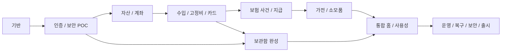

# v1.0.0 로드맵·마일스톤

마일스톤은 구현/검증 순서다. 아래 전체가 첫 정식 버전의 범위이며 중간 마일스톤만 완료한 상태를 v1로 출시하지 않는다.
예상 날짜·소요 기간은 임의로 정하지 않았다. 각 Issue에는 선행 작업과 검증 가능한 완료 조건이 있다.

| 마일스톤 | Issue | 완료 조건 |
|---|---|---|
| v1.0 / M0 — 기반·개발 품질 | SB-001~SB-004 | 문서의 목표 구조를 실제 실행 가능한 골격으로 만들고 양 플랫폼 기본 빌드 및 DB migration을 검증한다. |
| v1.0 / M1 — 공동 인증·보안 선행 검증 | SB-005~SB-009 | 타가계 접근 차단과 실기기 지문/Keystore proof가 통과하며 복구 설계의 미검증 가정을 기록한다. |
| v1.0 / M2 — 자산·금융계좌·월 기록 | SB-010~SB-013 | 두 달의 실제 확인치와 비교범위·정정 이력을 정확히 관리하고 중복 합산이 없다. |
| v1.0 / M3 — 수입·고정 납부·카드 연결 | SB-014~SB-018 | 예상/실제·원금/이자·카드승인/출금 구분과 카드 종료 영향 안내를 검증한다. |
| v1.0 / M4 — 보험계약·의료 사건·지급 | SB-019~SB-023 | 960,000원 의료비와 800,000원 보험금 예시, 환불/반환·분할 지급·청구 없는 지급을 통과한다. |
| v1.0 / M5 — 가전·소모품·재고 | SB-024~SB-027 | 입고와 교체가 구분되며 중복·동시 요청에서도 재고가 정확하다. |
| v1.0 / M6 — 보관함·기기별 보안 완성 | SB-028~SB-032 | 비밀 평문이 일반 API/bridge/백업에 없고 두 구성원·새 기기·복구 시나리오가 검증된다. |
| v1.0 / M7 — 통합 홈·양 플랫폼 사용성 | SB-033~SB-035 | Android/PC에서 7개 영역이 연결되어 사용 가능하며 홈 우선순위가 유지된다. |
| v1.0 / M8 — 운영·복구·v1 출시 검증 | SB-036~SB-040 | R-01~R-22, 모든 보안 게이트, 두 실기기와 PC의 사용자 여정이 통과한 뒤 v1.0.0을 출시한다. |

## 의존성 흐름

보험·가전 기능과 보관함 작업은 계약이 고정된 후 병렬 수행할 수 있다. 단, 같은 API/DB migration 파일을 무조정 병렬 편집하지 않는다.
보안 POC는 초기에 수행한다. 마지막 단계에서 지문/키복구 가능성을 처음 확인하지 않는다.

## 상태와 관리

GitHub Issue의 완료 기준·검증 근거가 작업 상태의 기준이다. backlog.json은 계획 원본이며 진행 중 사람의 체크리스트를 자동 덮어쓰지 않는다.
게시기는 재실행 시 기존 Issue 본문·완료 상태를 수정하지 않고 누락된 계획만 생성한다.
변경된 계획은 새 Issue 또는 의도적인 리뷰 변경으로 반영한다.

전체 작업: [Issue 원본](../planning/ISSUES.md), [기계 판독 계획](../planning/backlog.json).
